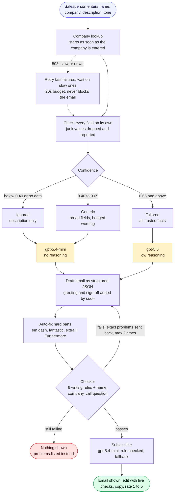

# Raphie Outreach

Writes cold outreach emails for Raphie's sales team: personalised to the prospect's company, tailored with go-to-market data when that data is trustworthy, and **only shown once code has verified every one of Raphie's writing rules**. Built for the Raphie coding challenge as a CLI (the brief's requirement) and a web app for salespeople, both on one shared core.

**Live demo:** https://raphie-personalized-outreach.vercel.app/ (the interface and company lookup work; generating emails needs an OpenAI key to be added in Vercel, see [Environment variables](#environment-variables)).


## Quick start

Requires Node 20+.

```bash
git clone https://github.com/jamamv/raphie-personalized-outreach.git
cd raphie-personalized-outreach
npm install
cp .env.example .env          # add your OPENAI_API_KEY
npm start                     # CLI: asks the four questions
npm run web                   # web UI at http://localhost:3000
npm run feedback              # how salespeople rated the emails
npm test                      # 53 unit tests, no network or key needed
npm run eval -- --reps 2      # live eval against OpenAI (see Evaluation)
```

### Environment variables

| Variable | Needed? | What it does |
|---|---|---|
| `OPENAI_API_KEY` | Required | Your OpenAI key. Locally it goes in `.env`; on Vercel, add it under Project → Settings → Environment Variables. |
| `ACCESS_CODE` | Optional, recommended for a public link | Any phrase. The web page asks for it once, so strangers can't spend your key. |

Everything else (models, retries, log files) has working defaults, listed in `.env.example`.

CLI flags skip the prompts: `--name`, `--company`, `--description`, `--tone direct|warm`, `--model`, `-v` (verbose), `--dry-run` (print the exact prompt without calling OpenAI).

The subject line and email go to **stdout only if the email passed every rule**. Everything else (questions, the helper report, warnings) goes to stderr, so `npm start > email.txt` gives a clean file. Exit codes: `0` ok, `1` error, `2` no draft passed the rules (nothing is printed as an email).

## What was built

**The product evolved in three steps.**
1. **CLI first**, as the brief asked. It is still the core (`npm start`).
2. **Then a chat**, because salespeople should not have to work in a terminal.
3. **Then a form.** Salespeople need to change one field and regenerate, edit before sending, and copy with one click. A chat locks answers into its history, and its hidden state caused a real bug (an old "Regenerate" button ran with cleared answers). The form fixed both.

**What a salesperson gets:**
* **Emails that follow the rules.** Every email shown passes all six of Raphie's rules, checked by code, and edits are checked live by the same code.
* **A subject line** that matches the email, editable and rerollable on its own.
* **Visible reasoning:** the lookup's confidence before generating, and "Why this email" listing every field used, withheld or dropped.
* **One-click copy**, regenerate, and undo for edits.
* **A 1 to 5 feedback score** with a comment, plus whether the email was copied and how much was edited.

**Stateless API:** the page passes the lookup result back when generating, so the helper is called once and the same code runs as serverless functions. Passed-back data goes through the same field checks as a live response.

## How it works



| File | Job |
|---|---|
| `src/helper.js` | Helper endpoint client. Retry policy based on measuring the endpoint. Never throws. |
| `src/insights.js` | Confidence tiers, per-field allow-lists, and the "why" report. |
| `prompts/system.md` | Every instruction the model gets: Raphie's offer, required content, company-type cheat sheet, writing rules, tone rules with examples. |
| `src/subject.js`, `prompts/subject.md` | Subject line: a small separate call on the light model, rule-checked, with a fallback. |
| `src/prompt.js` | Loads the instructions; builds the `<data>` block; adds greeting and sign-off. |
| `src/generator.js` | OpenAI Responses API call, sanitize, validate, repair loop. |
| `src/validator.js`, `src/sanitize.js` | The rules, in code. |
| `src/core.js` | The shared pipeline used by the CLI and the web server. Writes `runs.jsonl`. |
| `src/cli.js`, `src/web/` | The two interfaces. `src/web/handlers.js` holds the API handlers used both locally and on Vercel. |
| `api/`, `vercel.json`, `scripts/build-web.js` | Vercel deployment: one serverless function per endpoint, plus a build step that copies the page into `public/`. |
| `src/feedback.js` | Validates salesperson scores and summarises them (`npm run feedback`). |
| `scripts/eval.js`, `scripts/compare.js` | Live evaluation and before/after comparison. |

## Error scenarios

**The salesperson's input**

| Scenario | What happens |
|---|---|
| A field is left empty | CLI asks again (*"This field is required."*); the web Generate button stays disabled; the API returns 400. |
| Tone is not direct or warm | CLI asks again (*"Please enter "direct" or "warm"."*); the API returns 400. |
| Wrong or missing access code (when `ACCESS_CODE` is set) | 401, and the page asks for the code: *"That access code is not right."* |

**The company lookup improves the email but never blocks it.**

| Scenario | What happens |
|---|---|
| 503s, slow answers or hangs | Fast failures are retried up to 4 times; slow ones get up to 15s, within a 20s budget. |
| Every attempt fails | Written from the description: *"Company lookup unavailable: writing from your description."* |
| Confidence below 0.40 | Helper ignored: *"Company data is unreliable (confidence 0.22): writing from your description."* |
| A junk field, even at high confidence | Only that field is dropped, shown with a ✗ in "Why this email". |

**The draft.** Hard bans are fixed in code; every other rule failure goes back to the model with the exact problem, at most twice (see [the rules](#raphies-six-rules)). If it still fails, **nothing is shown as an email**: the CLI lists the problems and exits with code 2, and the web page shows them with a Try again button. OpenAI errors are retried twice, then reported the same way.

**The subject** falls back to "Support at {company}" if it fails its rules twice, so it never blocks the email.

**The salesperson's edits (web UI)**

| Scenario | What happens |
|---|---|
| An edit breaks a rule | Flagged live: a red *"✗ 2 rule problems"* badge with the list. Copy becomes **"Copy anyway"**, and "Undo my edits" restores the original. |
| A subject edit breaks a rule | The problem appears under the subject as you type. |
| An old button clicked after Clear | Ignored. Stale responses are dropped. |

## Key decisions

### Measure the helper endpoint before trusting it

I measured the endpoint with about 45 calls before settling the design, because the spec only says it is "typically fast" with occasional 503s.

| Finding | Design consequence |
|---|---|
| 503s were **about 3 in 10 calls**, even one at a time, and arrive in ~0.1s | Fast failures are retried quickly (up to 4 attempts) |
| Normal answers take 3 to 4s, sometimes 10 to 17s; under parallel load some calls hung for 25s+ | Each attempt waits up to 15s; the lookup starts as soon as the company name is typed |
| The server handles one request at a time, and **a cancelled request still keeps it busy** (the next call took 6.0s instead of 4.0s) | A slow request is never cancelled and retried, which would only add load |
| The same company scores differently on every call (one company: 0.71 and 0.78; another: 0.73 to 0.96) | Thresholds sit away from where real scores cluster |
| Scores fall into two groups: **0.15 to 0.32** for unknown companies, **0.70 to 1.0** for real iGaming companies | See the confidence policy |
| Junk values appear **even at confidence 0.99**: `companyType: "error: could not classify company"`, `"n/a"`, `"elevated"`, `"INTL"`, `null` lists | Every field passes its own allow-list |
| Two fields not in the spec appear in most responses: `likelyTicketDrivers` and `complianceThemes` | They are the most specific data available and are used when trusted |

Real responses, including the messy ones, are saved in `test/fixtures/helper-responses.json` and used by the tests and the eval.

### Confidence policy: three tiers, and every field checked on its own

| Confidence | Tier | What the model gets |
|---|---|---|
| below 0.40 | **ignored** | No helper data. The email is written from the description alone. |
| 0.40 to 0.65 | **generic** | Only broad fields: a company type hint and support motion. The model describes what teams like theirs usually face and states nothing as fact about this company. |
| 0.65 and above | **tailored** | All valid fields: ticket drivers, compliance themes, regions, KYC/AML intensity, crypto. Still framed as an outside view, never as inside knowledge. |
| helper failed | **none** | Same as ignored. The helper improves the email but never blocks it. |

**Why these lines.** A wrong specific claim hurts a cold email more than a vague one ("your US operations" sent to a UK-only company ends the conversation), so the most specific fields need the most confidence. Real companies scored 0.70 to 1.0 but moved by 0.1 to 0.2 between calls. A line at 0.70 would flip the same company between tiers from one run to the next, so the tailored line sits at 0.65, just under that cluster. Unknown companies scored at most 0.32, so 0.40 cleanly separates them.

**Confidence is per response, but junk is per field.** Every field must also pass an allow-list (known company types, known support motions, low/medium/high, real region codes, plain-label tag lists). Each decision is reported, in the CLI and under "Why this email" in the web UI:

```
Helper confidence 0.99 → tailored, specific helper facts allowed
  ✗ companyType: dropped, "error: could not classify company" is not an iGaming company type
  ✓ supportMotion: used (white_glove)
  ✓ likelyTicketDrivers: used (KYC, account access, verification delays, document review, API integration)
  ✓ operatingRegions: used (US, Europe)
  - isCryptoRelated: skipped (false), not crypto, not a talking point
  - vertical: skipped (fintech), Raphie only targets iGaming, adds nothing
```

**The description always wins.** The salesperson wrote it. When the helper disagrees (it calls the payments provider ApexPay a "platform"), the model is told to follow the description, and it reports the company type it chose so this can be checked.

**Fields treated as noise:** `vertical` (Raphie only targets iGaming), `isCryptoRelated: false` (absence of crypto is not a talking point), and vague regions like "INTL" or "global".

### The model writes; code enforces the rules

The model is asked to follow the rules, but **code decides**.

**How the checker reads an email.** Every line is split into sentences after `.`, `!` or `?` followed by a space; common abbreviations (e.g., i.e., U.S., Dr.) do not end a sentence. The greeting ("Hi Jane,") and the sign-off ("Best," and "Raphie") count as sentences, the stricter reading. A word is any space-separated token containing a letter or digit, so "15-minute" and "policy-aware" are one word each. Comparisons ignore upper and lower case.

#### Raphie's six rules

| Rule | What breaks it | Example that fails | What happens |
|---|---|---|---|
| **No em dashes** | The em dash `—` anywhere, with or without spaces. A spaced en dash ` – ` and a spaced double hyphen ` -- ` count too, as the usual substitutes. An unspaced en dash in a range ("2–3") is allowed. | "We help — fast." | Code replaces it with a comma: "We help, fast." |
| **No "Furthermore" or "Additionally" at the start of a sentence** | Either word as the first word of any sentence, followed by a comma, a colon or nothing. Mid-sentence use is fine. | "Additionally, we route KYC cases." | Code removes the word and capitalises the next one: "We route KYC cases." |
| **No "fantastic"** | The word anywhere, in any case, including "Fantastic" and "fantastically". | "That is a fantastic result." | Code replaces it ("great", or "remarkably" for "fantastically"), keeping the capital letter. |
| **At most one exclamation mark** | More than one `!` in the whole email, greeting and sign-off included. | "Hope you're well! Quick idea!" | Code collapses "!!" to "!", then turns every extra `!` into a period. |
| **No two consecutive sentences starting with the same word** | Two sentences in a row with the same first word, ignoring case and apostrophe style. | "We automate KYC tickets. We also help agents." | Sent back to the model, quoting both sentences. |
| **No sentence over 30 words** | 31 or more words in one sentence. Exactly 30 is allowed. The prompt asks for 25 to leave headroom, since models count poorly. | A 34-word sentence | Sent back to the model, quoting the sentence and its word count. |

#### Required content (from the brief's "the email must include")

| Rule | What breaks it | Example that fails | What happens |
|---|---|---|---|
| **The recipient's name** | The first name is missing as a whole word. The first name is the first word typed, skipping titles (Mr, Mrs, Ms, Miss, Mx, Dr, Prof, Sir), and works in any alphabet. A longer name does not count: "Josefina" is not "José". | Name typed "Dr. Jane Doe", email never says "Jane" | Sent back to the model. In practice it cannot fail, because code writes the greeting "Hi Jane," itself. |
| **The company name** | The company name exactly as typed is missing (any case). Part of it does not count. | Company "Riverline Sportsbook", email only says "Riverline" | Sent back to the model. |
| **A call request** | The email has no `?`, or none of the words call, chat, conversation, meet, meeting or talk. Both are needed. | "Let me know if this sounds useful." | Sent back to the model. |
| **The sender** | The word "Raphie" is missing. | | Cannot fail in practice: code adds "Raphie" in the sign-off. |

#### Soft check

| Check | What triggers it | What happens |
|---|---|---|
| **Buzzwords** | leverage, seamless, synergy, unlock, game-changer, cutting-edge, elevate, delve, robust, empower, revolutionise, best-in-class, world-class, holistic, paradigm, transformative, supercharge, streamline, "finds you well", fast-paced | A note is shown, but the email is not rejected: this is style guidance, not one of Alex's rules. |

**Subject lines** are not in the brief, but every real cold email needs one. After an email passes, a small separate call on the light model (`src/subject.js`, `prompts/subject.md`) writes a 2 to 6 word subject from the finished email, so it always matches the body. Code checks it (`checkSubject` in `src/validator.js`): 2 to 8 words, at most 60 characters, and no exclamation marks, dashes, "fantastic", emojis, fake "Re:"/"Fwd:" or shouting in capitals. A failing subject is retried once with the problems listed, then replaced by a plain fallback, so the subject can never block the email. It costs about $0.20 per 1,000 emails, and in the web UI it is editable, checked live, copyable on its own, and can be rerolled with "New subject" without rewriting the email.

#### Subject line rules

| What breaks it | Example that fails |
|---|---|
| Fewer than 2 or more than 8 words | "Hi" |
| More than 60 characters | |
| An exclamation mark | "Big idea for you!" |
| Any dash: em, en or `--` | "support — fast" |
| The word "fantastic" | "A fantastic idea" |
| Pretending to be a reply or forward | "Re: our chat", "Fwd: support" |
| An emoji | "support 🚀 ideas" |
| A word of 4+ capital letters that is not an industry acronym (GDPR, LATAM, APAC, EMEA, MENA, NFL, NBA, UEFA, FIFA; 3-letter ones like KYC always pass) | "FREE support automation" |

A failing subject is sent back once with the problems; if it still fails, the fallback "Support at {company}" is used.

Structural problems go back to the model with the offending sentences quoted, at most twice. If the email still fails, **nothing is printed as an email**: the CLI exits with code 2 and lists the problems, and the web UI shows the problems instead of a draft. Buzzwords (leverage, seamless, unlock...) produce a warning, not a failure, since they are style guidance rather than one of Alex's rules.

**The brief's own examples break the 30-word rule.** Example #1 has a 32-word sentence; example #2 has 32- and 33-word sentences. Models imitate examples more than they follow rules, so the examples in `prompts/system.md` are the originals with only those sentences trimmed to 30 words or fewer. They still read like Alex's examples, and they no longer teach the model to break the rule it is checked on.

### Prompt design: instructions and data kept apart

- **Instructions and data are separate.** `prompts/system.md` holds every instruction, readable as a document. The inputs and helper facts go in a `<data>` block that the model is told to treat as information, never instructions. Helper tag lists are reduced to plain labels, so free text from the endpoint cannot inject instructions.
- **Facts go in as data, not sentences.** The first version described each company type in polished prose, and the model pasted it into every email ("Given your US footprint" appeared verbatim). Now the cheat sheet is a terse table and helper facts are short labels.
- **"Beyond the description" is made explicit.** Code works out which helper facts the salesperson did not already mention (`notInDescription`), and the prompt asks the model to build at least one point on the most specific of them.
- **Tone has rules plus a full example.** Direct leads with who we are and asks for a specific slot. Warm opens with one friendly line and makes a soft ask with no time slot. Sign-offs follow the brief's examples.
- **Structured output.** The model returns `{accountType, helperFactsUsed, paragraphs}`. Code adds "Hi {first name}," and the sign-off, so those can never be wrong, and the chosen company type is visible for checking.
- **Model.** Routed by confidence tier: `gpt-5.5` with low reasoning when there are trusted helper facts, `gpt-5.4-mini` without reasoning otherwise. See "Cost and model choice".

### Cost and model choice: reasoning only where it pays off

Every eval run records real token usage (input, cached input, output, reasoning) and prices it with OpenAI's published rates (`scripts/prices.js`). Same 9 scenarios, 2 runs each:

| Setup | Rules pass | First try | Tokens in/out | $ per 1,000 emails | Seconds | Verdict |
|---|---|---|---|---|---|---|
| gpt-5.5, reasoning low | 100% | 100% | 1771/196 | $14.74 | 3.4 | Best tailoring (5/6 in the A/B) |
| gpt-5.5, reasoning off | 100% | 100% | 1771/141 | $13.08 | 2.8 | Tailoring drops to 3/6 |
| gpt-5.4-mini, reasoning off | 100% | 89% | 1976/162 | $1.06 | 1.5 | Good writing, rarely uses helper-only facts (1/6) |
| gpt-4o | 100% | 78% | 2196/166 | $5.39 | 2.0 | Copies the examples most |
| gpt-4.1-mini | 100% | 83% | 2366/195 | $0.80 | 2.0 | Copies the examples closely |
| gpt-5.4-nano, reasoning off | 100% | 61% | 2534/218 | $0.78 | 2.6 | Awkward phrasing, overclaims |
| gpt-4o-mini | 100% | 72% | 2331/172 | $0.33 | 2.8 | Reads as AI ("is crucial", "navigates a complex landscape") |
| **Routed (default)** | **100%** | **89%** | **1988/201** | **$11.54** | **3.1** | **Tailoring kept (4/6), 22% cheaper** |

What the numbers say:
- **The eval itself costs no model tokens.** Every check is deterministic code, so tokens are only spent on writing emails.
- **Rule compliance does not depend on the model.** Code enforces it; weaker models just need more repair calls, which costs input tokens.
- **Input is about 90% of the tokens**, mostly the fixed instructions. They come first in every request with a `prompt_cache_key`, so OpenAI's prompt cache serves them: 85 to 88% of input tokens were cached on gpt-5.4-mini. (gpt-5.5 showed no cache hits in these runs.)
- **Reasoning only pays off when there are trusted helper facts to weave in.** It took tailoring from 3/6 to 5/6 on gpt-5.5 and added nothing when writing from the description alone.

So the default **routes by confidence tier**: emails with trusted helper data (the tailored tier) use gpt-5.5 with low reasoning; everything else (generic, ignored, helper down) uses gpt-5.4-mini with reasoning off, about 12 times cheaper per email. Override with `OPENAI_MODEL`, `OPENAI_LIGHT_MODEL` and their `_REASONING_EFFORT` variables, or `--model` to force one model. At $0.01 per email, cost is not what limits this tool, but the routing keeps spend tied to where it changes the output.

**Next step with more time:** move the "which helper fact to use" decision from the model into code (pick the most specific fact deterministically and pass it as a must-mention). Then the cheap model would only need to follow an instruction, not make a judgement, and could likely handle the tailored tier too.

## Evaluation

`npm run eval` runs 9 fixed scenarios against the live OpenAI API, with **recorded** helper responses so the model is the only variable. Scenarios: both brief examples, an affiliate, a crypto casino, a conflict (helper says "platform", description says payments), an unknown company the helper thinks is a manufacturer, a helper outage, a junk company type at 0.99, and a tailoring A/B (the same description and helper payload at confidence 0.97 and 0.2). `npm run compare` rescores saved runs with the current checks.

Results (2 runs per scenario; full emails in `eval/results/`):

| | Baseline (first version) | Now, gpt-5.5 | gpt-5.4-mini | gpt-4.1-mini |
|---|---|---|---|---|
| Passes every rule (after repair) | 100% | 100% | 100% | 100% |
| Passes on the first try | 83% | **100%** | 94% | 89% |
| Writes for the right company type | 100% | 100% | 100% | 100% |
| No helper facts leak at low confidence | 100% | 100% | 100% | 100% |
| Avg seconds per email | 1.3 | 3.0 | 2.8 | 1.8 |

The tailoring A/B, run 6 times each on gpt-5.5, shows the helper changes the email and the policy gates it. Facts only the helper knows (US and Canada) appeared in **5 of 6** emails at confidence 0.97 and **0 of 6** at 0.2, with the description unchanged.

**Why gpt-5.5 (for tailored emails).** It passed every rule on the first try and stayed furthest from the examples' wording. The cheaper gpt-5.4-mini now handles every email without trusted helper data; see "Cost and model choice". gpt-4.1-mini is faster but copies the example sentences closely ("We help support teams automate...", "policy-aware replies").

**What did not improve (honest notes).**
- **Repetition across companies went up.** The number of 3-word phrases shared by at least half of the companies rose from 13 to 27. Most come from Alex's examples, which the new prompt uses as the house voice: every email opens "I'm reaching out from Raphie" and asks "Would you be open to...". Each recipient sees only their own email, so this matters less than per-email quality, but it is the next thing I would work on.
- **The A/B scores the same as the baseline on regions.** The baseline also mentioned the US, through a hard-coded sentence in code ("US state-by-state requirements"). The real differences are elsewhere: the baseline discarded `likelyTicketDrivers` and `complianceThemes`, let a junk 0.71 payload drive its region text, cancelled-and-retried slow helper calls (one run took 24s), and printed failing drafts to stdout.

## Sample emails (real output)

Riverline Sportsbook, direct, helper trusted (0.96):

```
Hi Jane,

I'm reaching out from Raphie. We help sportsbook support teams automate repetitive player questions around withdrawals, KYC status, and account access.

Riverline Sportsbook likely sees those tickets spike around big game days, especially across US and Canada player flows. Raphie deflects the common versions fast, suggests replies that match your policies, and routes sensitive KYC or payment cases to agents with context.

Would you be open to a 15-minute call next week to see if this could reduce repeat tickets for your team?

Best,
Raphie
```

ApexPay Gaming, warm. The helper says "platform", the description says payments, and the email is written for a payments company:

```
Hi Jane,

Hope you're doing well. I'm reaching out from Raphie because ApexPay Gaming likely sees a lot of repeat questions around payout status, failed payments, and fraud reviews.

For a payments team handling card, ACH, and crypto flows, those tickets can pile up fast from both operators and end users. Raphie automates the repetitive parts, suggests replies that match your policies, and hands fraud, KYC, or PII-sensitive cases to agents with context.

Would you be open to a short conversation to see whether this could reduce ticket volume and speed up responses?

Warm regards,
Raphie
```

"Acme Widgets", direct. The helper thinks it is a manufacturer (0.22), so it is ignored, and the email follows the description (an odds data provider):

```
Hi Maria,

I'm reaching out from Raphie. Acme Widgets looks like the kind of sports data feed provider where support gets pulled into urgent tickets on feed latency, outages, and data discrepancies during live events.

Raphie helps teams automate the first pass on those tickets, gather the right context, and give agents suggested replies that match your process. That means operator clients get faster updates, while complex incidents still move to the right human with the details attached.

Would you be open to a 15-minute call next week to see if this could be useful for Acme Widgets?

Best,
Raphie
```

## Run log

Every CLI or web run appends one line to `runs.jsonl` (gitignored), with a `runId` that feedback in `feedback.jsonl` refers to: inputs, the raw helper response, tier, field report, model, token usage, company type, whether it passed, repairs, warnings, the subject, the email and timing. Use it to compare runs (same company, other tone or model) and to review real confidence scores over time. Set `RUN_LOG=off` to disable it.

## What's next

- **Reduce cross-company repetition**: vary openers and asks, and tune against the stock-phrase metric with more runs.
- **Calibrate thresholds per field** against ground truth, since region accuracy and company-type accuracy probably differ.
- **Ask the helper twice and keep the agreeing fields**, since it is non-deterministic.
- **An LLM judge** for "sounds human" and relevance, alongside the mechanical checks.
- **Web research** for recent company news as an extra, clearly-sourced fact.
- **Batch mode** from a CSV, using the same core.
- **For production use:** measure replies and meetings booked (via the CRM), not just salesperson scores; check a do-not-contact list (existing customers, opt-outs) before writing; follow-up sequences; and a retention policy for `runs.jsonl`, which holds names and emails (GDPR matters in an EU/UK-heavy industry).

### Roadmap: from drafting emails to sending them

Today a person reviews every email. The tool should earn the right to send, one stage at a time, unlocked by data rather than dates.

| Stage | What it adds | Unlocked when |
|---|---|---|
| **1. Drafting** (today) | Generate, edit, copy, rate | Done |
| **2. One-click send** | Send from the salesperson's own Gmail or Outlook | Most emails rated 4–5 with few heavy edits |
| **3. Daily drafts from the CRM** | A morning job drafts emails for new leads into an approval queue | The golden set passes and approvals rarely need edits |
| **4. Auto-send the safest cases** | High-confidence emails in proven segments send on their own; the rest stay in the queue | Auto-sent emails get the same reply rate as reviewed ones |

* **Golden set:** emails rated 5 and sent unchanged become good examples; low-rated or heavily edited ones become test cases. Every prompt or model change must pass it.
* **Follow-ups:** 2–3 short follow-ups that each add something new, stopping when the prospect replies or opts out.
* **Do-not-contact checks:** skip existing customers, open deals and opt-outs before anything is written.
* **Learn from replies:** record each email's outcome (reply, meeting, no reply, opt-out) by `runId`, then compare reply rates by tone, confidence tier, company type, model and subject. `runs.jsonl` already records most of this. Winners feed the golden set; losers become new checks.
* **Guardrails:** opt-out line and GDPR handling, daily sending limits per mailbox, a kill switch, and an audit trail.

## Stack

| Layer | Tech |
|---|---|
| Runtime | Node.js 20+, ES modules |
| AI | OpenAI Responses API with structured outputs; `gpt-5.5` (tailored emails) and `gpt-5.4-mini` (other emails, subject lines) |
| Server | Node's built-in `http` locally; Vercel serverless functions in production |
| Web UI | One HTML page, plain JavaScript, no framework |
| Tests | Node's built-in test runner, no network or key needed |
| Dependencies | `openai`, `dotenv` |

## Scripts

| Command | Description |
|---|---|
| `npm start` | CLI: asks the four questions, prints the subject and email |
| `npm run web` | Web UI at http://localhost:3000 |
| `npm test` | Unit tests (no network or API key) |
| `npm run eval` | Live eval against OpenAI with recorded helper responses (`--model`, `--effort`, `--reps`, `--label`) |
| `npm run compare` | Compare saved eval runs side by side, including cost |
| `npm run feedback` | Summary of salesperson feedback scores |

## AI usage

AI coding assistants were used throughout: for implementation, code review, and running and analysing the evals. The product decisions (CLI to chat to form, what to measure, the confidence thresholds, routing models by need) and the scope trade-offs are mine.
